<picture>
  <source media="(prefers-color-scheme: dark)" srcset="./dark.svg">
  <source media="(prefers-color-scheme: light)" srcset="./light.svg">
  
</picture>

 

<picture>
  <source media="(prefers-color-scheme: dark)" srcset="https://streak-stats.demolab.com/?user=KartikeyaWarhade2002&background=0A101F&border=1C2A47&ring=A78BFA&fire=10B981&currStreakNum=E2E8F0&sideNums=E2E8F0&currStreakLabel=22D3EE&sideLabels=22D3EE&dates=64748B">
  <source media="(prefers-color-scheme: light)" srcset="https://streak-stats.demolab.com/?user=KartikeyaWarhade2002&background=F8FAFC&border=CBD5E1&ring=7C3AED&fire=10B981&currStreakNum=0F172A&sideNums=0F172A&currStreakLabel=0891B2&sideLabels=0891B2&dates=64748B">
  
</picture>

 

<picture>
  <source media="(prefers-color-scheme: dark)" srcset="https://github-readme-stats-sigma-gules-24.vercel.app/api?username=KartikeyaWarhade2002&show_icons=true&hide_rank=true&bg_color=0A101F&border_color=1C2A47&title_color=22D3EE&text_color=E2E8F0&icon_color=A78BFA">
  <source media="(prefers-color-scheme: light)" srcset="https://github-readme-stats-sigma-gules-24.vercel.app/api?username=KartikeyaWarhade2002&show_icons=true&hide_rank=true&bg_color=F8FAFC&border_color=CBD5E1&title_color=0891B2&text_color=0F172A&icon_color=7C3AED">
  
</picture>
<picture>
  <source media="(prefers-color-scheme: dark)" srcset="https://github-readme-stats-sigma-gules-24.vercel.app/api/top-langs/?username=KartikeyaWarhade2002&layout=compact&langs_count=8&bg_color=0A101F&border_color=1C2A47&title_color=22D3EE&text_color=E2E8F0">
  <source media="(prefers-color-scheme: light)" srcset="https://github-readme-stats-sigma-gules-24.vercel.app/api/top-langs/?username=KartikeyaWarhade2002&layout=compact&langs_count=8&bg_color=F8FAFC&border_color=CBD5E1&title_color=0891B2&text_color=0F172A">
  
</picture>

 

<picture>
  <source media="(prefers-color-scheme: dark)" srcset="https://raw.githubusercontent.com/KartikeyaWarhade2002/KartikeyaWarhade2002/output/snake-dark.svg">
  <source media="(prefers-color-scheme: light)" srcset="https://raw.githubusercontent.com/KartikeyaWarhade2002/KartikeyaWarhade2002/output/snake.svg">
  
</picture>

  
  &nbsp;&nbsp;
  

